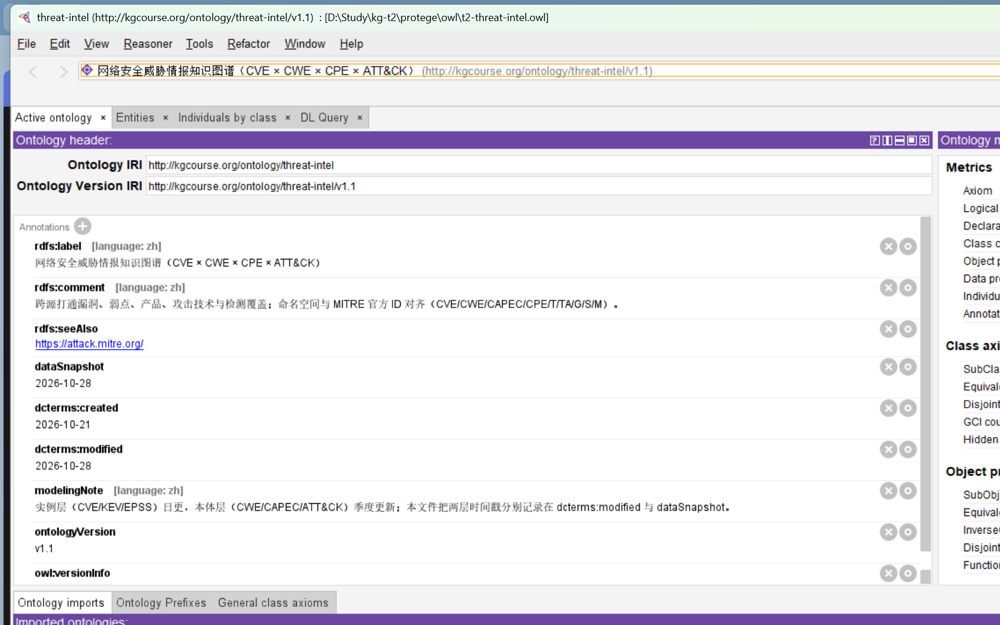
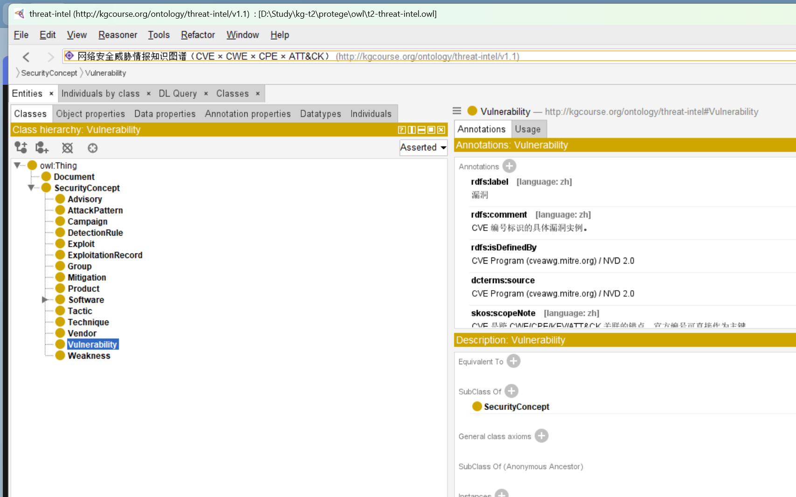
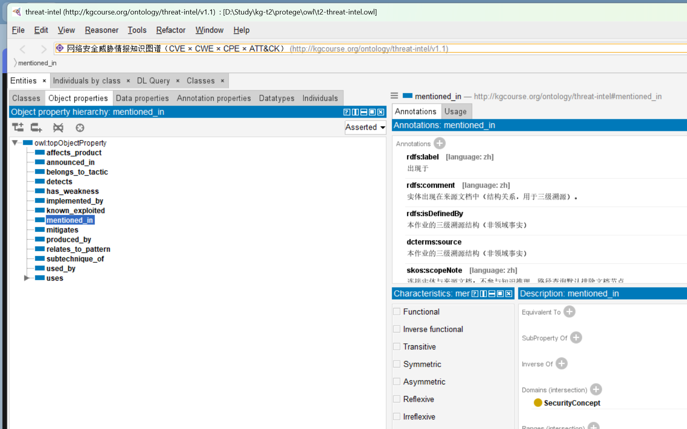
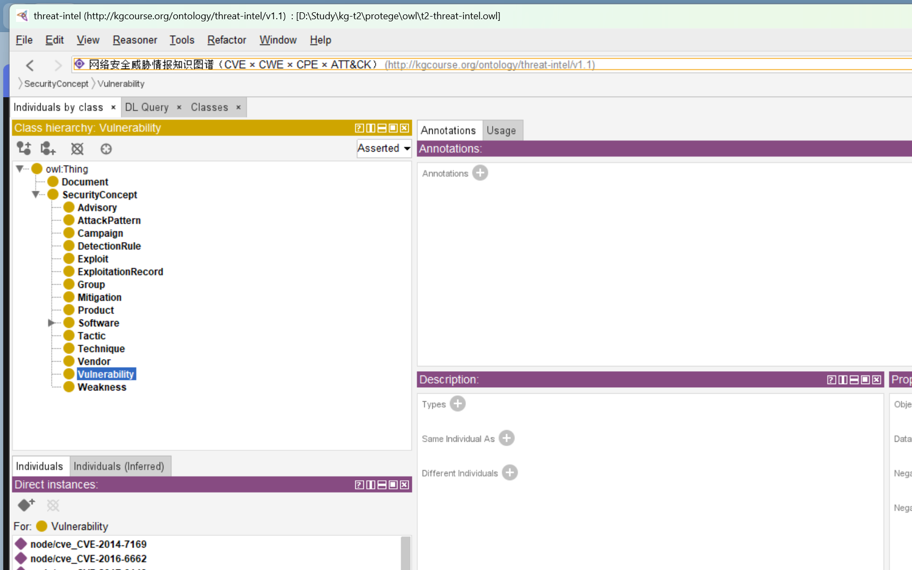
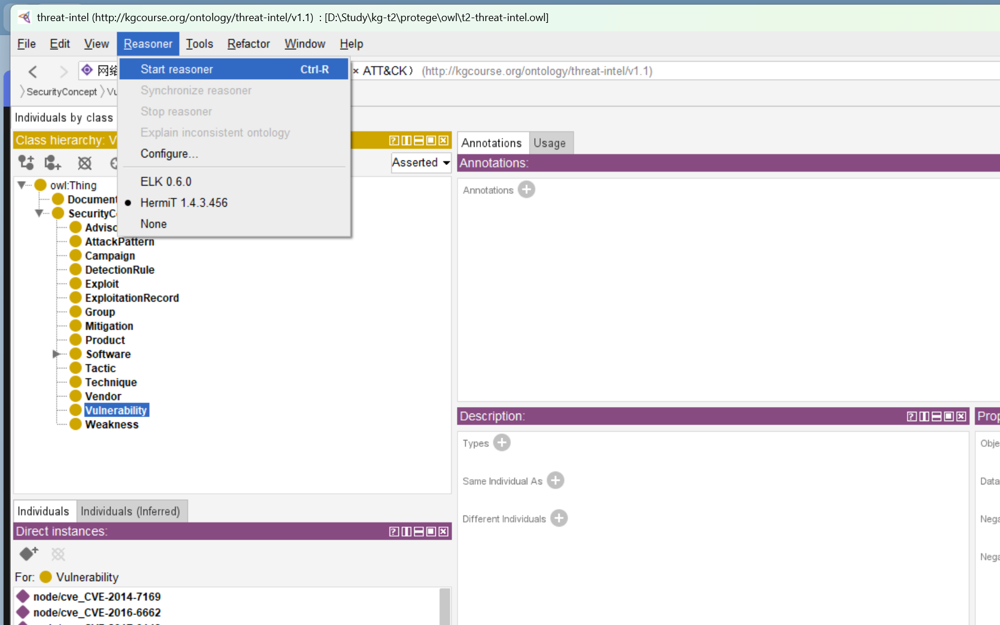

# 题目二　Protégé 实现与全流程跑通详解

> 项目目录：`D:\Study\kg-t2`
> 题目依据：`D:\Study\选题介绍-知识图谱网络工程8选题.pdf` 中的 **T2 网络安全威胁情报知识图谱（CVE × CWE × CPE × ATT&CK）**
> 桌面工具：`D:\tools\Protege-5.6.9`（Protégé 5.6.9，内置 Temurin JRE 11.0.25）
> 验证日期：2026-10-28
> 配套实验报告：`report/题目二-威胁情报知识图谱实验报告.md`

本文回答三件事：

1. 题目二到底要求什么，评分点落在哪里；
2. 仓库里已有的流水线做了什么、指标怎么读；
3. 怎样把这些成果变成 Protégé 里**能打开、能浏览、能推理、能查询**的 OWL 文件，并逐项复现。

---

## 0　先看结论

| 验收项 | 结果 | 证据文件 |
|---|---|---|
| 本体规模 | 19 类 / 17 对象属性 / 22 数据属性 | `topics/t2-cve-attack/ontology.json` |
| 实例规模 | 421 个 `owl:NamedIndividual` / 1572 条断言对象属性边 | `protege/reports/build_report.md` |
| OWL 三元组 | TBox 411；TBox+ABox 17,966 | `protege/owl/` |
| 公理级证据 | 1572 条边全部带 `owl:Axiom` 注解 | 同上 |
| 官方编号 | 12 个受检类覆盖率均为 100% | `protege/reports/official_id_check.json` |
| OWL 2 DL | HermiT 判定一致；0 个不可满足类；0 个 profile 违规 | `protege/reports/reasoner_results.md` |
| 推理新增 | 406 条类断言 + 310 条对象属性边 | 同上 |
| 能力查询 | 10 条 SPARQL 全部返回预期结果 | `protege/reports/query_results.md` |
| 跨源映射 | 7 组，抽样召回均为 100% | `data/reports/t2-cve-attack_cross_source.md` |
| 问答 | 12 题；检索 27/27；答案覆盖 27/27；拒答 2/2；幻觉率 0% | `data/reports/t2-cve-attack_qa_bench.md` |
| 一键复现 | `scripts\run_t2.cmd` 15 步全通过（exit 0） | `build/run_t2_verify.log` |

一句话：**题目二的流水线本身已经跑通；本次新增的是把流水线产物无损、可追溯地导出为 OWL 2 DL，并在桌面版 Protégé 中实际打开、浏览，再用 Protégé 自带的 OWL API + HermiT 做一致性/可满足性/轮廓核验与 SPARQL 能力题。**

---

## 1　题目要求、验收点与评分对照

### 1.1 T2 的一句话与三阶段

PDF 对 T2 的定位是：

> 跨源打通漏洞、弱点、受影响产品与攻击技术，回答“我们这批设备当前暴露什么攻击面、有没有检测覆盖”。这是**跨源 ID 对齐**的真实战场。

题目骨架分三阶段：

| 阶段 | PDF 要求 | 本仓库对应 |
|---|---|---|
| ① 本体构建 | 13 类 / 13 关系起步；ID 主键化；版本标注 | 扩展到 **19 类 / 17 关系 / 22 数据属性**，见 §3 |
| ② 三种方法 | A 规则/ID 正则 + 结构化映射；B 安全文本 NER；C LLM 抽 TTP | 三条方法 + 金标准 + 融合，见 §8 |
| ③ Agent 应用 | 暴露面问答、检测覆盖分析、跨源 join 覆盖率抽样 | 12 题问答 + 4 个 MCP 工具 + 7 组映射核验，见 §9、§10 |

PDF 的示意骨架列出 12 个类名（页面写“13 类/13 关系”），本实现以仓库里的 `ontology.json` 为准扩展到 19 类。扩展不是“多加几个名词”，而是每一类都能在本切片里找到实例或明确说明为什么暂时为空（见 §3.6）。

### 1.2 五个验收点

| # | PDF 验收点 | 本项目结果 | 说明 |
|---|---|---|---|
| 1 | ≥3 组跨源 ID 映射并抽检覆盖率 | **7 组**，每组抽样 8 条人工可复核 | §9.1 |
| 2 | 本体命名空间与官方 ID 一致 | 12 个类 100% 合法官方编号 | §3.5 |
| 3 | KEV 覆盖率 | 40 条 CVE 切片 **40/40**；全图 45 个漏洞节点中 40 个有 KEV 记录 | §9.4 |
| 4 | 幻觉率（单方法 vs 融合） | 两套图均为 0%；无图谱基线 58.33% | §10.2 |
| 5 | 逐源许可清单 | 7 个公开源逐项列出，见 §2.1 | §2 |

### 1.3 三个“坑”及处理

| PDF 提醒的坑 | 本项目的处理 |
|---|---|
| 许可证拼盘（ExploitDB GPLv2+、Sigma DRL 1.1、ENGAGE 非商用） | 本切片**不使用 ExploitDB / ENGAGE**；Sigma 只保留规则元数据（UUID/标题/标签/描述），不复制检测逻辑正文。逐源许可见 §2.1，最严条款是 **DRL 1.1** 与 **MITRE Terms（需署名）** |
| 实例层日更、本体层季度更新，必须分层记录时间戳 | 本体文件用 `dcterms:modified` 记本体层修改日（2026-10-28），用 `dataSnapshot` 记实例快照日（2026-10-28）；`dcterms:created` 保留 2026-10-21。正文 §2.4 解释为什么两个日期要分开 |
| 资源名易错：HF 是 `s0u9ata/security-kg`，`S0UGATA` 是 GitHub 组织名 | 本仓库**没有**把 Hugging Face 数据集当作数据源；仅使用 NVD/CVE、CISA KEV、MITRE ATT&CK/CWE/CAPEC、SigmaHQ、FIRST EPSS 的官方接口与公开文件。本文保留这条提醒，避免后续误引 |

### 1.4 100 分评分表与本项目的对应

评分口径来自 `docs/学生作业说明.md` 与 `docs/作业方案.md` §6：

| 维度 | 权重 | 本项目证据 |
|---|---:|---|
| 本体质量 | 15 | 19 类 / 17 关系 / 22 数据属性；有来源、有建模理由；`kgc.ontology --check` 通过；OWL 2 DL 0 违规 |
| 数据与合规 | 10 | 7 个公开源、逐源许可、下载日期、SHA-256 记录；三道红线见 §2.3 |
| 方法 A 规则 | 8 | ID 正则 + 结构化映射；实体 F1 0.9823、三元组 F1 0.9943（口径见 §8.5） |
| 方法 B 模型 | 12 | 文档级 5 折交叉验证；留出实体 F1 0.8774；关系召回瓶颈有归因（§8.3） |
| 方法 C LLM | 12 | 本体约束 + 证据子串校验 980/985；越界/坏引用计数后丢弃；零样本 |
| 融合与质量 | 10 | 三路投票 1/2/3 票 = 788/402/382；质量门槛丢弃 44 个非官方实体；融合 F1 0.9781 |
| 阶段三应用 | 15 | 12 题问答、27/27 检索与答案覆盖、2/2 拒答、19/19 可溯源句、4 个 MCP 工具 |
| 报告与可复现 | 8 | 一条命令 `scripts\run_t2.cmd`；日志、指标、报告齐备；本文给出逐步复现 |
| 答辩 | 10 | 本文 §14 给出“针对代码提问”的回答要点 |

公共热身 T5 的 5 分**独立计分**，不属于题目二交付；本仓库虽保留了 T5 的流水线与产物用于对照，但本文不声称该 5 分。加分项（金标准工作坊、脚手架改进、多跳扩展）也**未在本项目中申报**，避免把“已有能力”写成“已获加分”。

---

## 2　数据源与合规

### 2.1 逐源清单

来源配置在 `topics/t2-cve-attack/sources.yaml`，每个语料文件都能反查到源、许可证与取数口径。

| 源 | 语料文件 | 许可证 | 本切片取什么 |
|---|---|---|---|
| NVD CVE API 2.0 + CVE Services API 2.1 | `cve_records_01..04` | 美国政府公开数据（public domain）；CVE 记录遵循 CVE Program Terms of Use | CVE 编号、描述、CWE、CPE 配置、参考链接 |
| CISA KEV Catalog | `kev_slice` | 美国政府公开数据（public domain） | CVE、厂商/产品、收录日期、整改截止、勒索软件标记 |
| MITRE ATT&CK Enterprise (STIX 2.x) | `attack_groups` / `attack_mitigations` / `attack_software` / `attack_tactics` / `attack_techniques` | CC BY 4.0 | T/TA/G/S/M 编号、名称、描述、tactic/technique 关系 |
| MITRE CWE (XML 4.20) | `cwe_weaknesses` | MITRE CWE Terms of Use（免费使用，需署名） | CWE 编号、名称、描述、Related Attack Patterns |
| MITRE CAPEC (XML 3.9) | `capec_patterns` / `capec_crosswalk` | MITRE CAPEC Terms of Use（免费使用，需署名） | CAPEC 编号、名称、描述、与 ATT&CK 技术的映射 |
| SigmaHQ Detection Rules | `sigma_rules` | Detection Rule License (DRL) 1.1 | **只保留元数据**：UUID/标题/标签/描述；不复制规则正文逻辑 |
| FIRST EPSS API | `epss_scores` | CC BY 4.0 | CVE、EPSS 分数、百分位 |

数据通道校验记录在 `data/reports/t2-cve-attack_data_channel.md`：每个源都有 URL、本地文件、大小、SHA-256 前 16 位与许可证。下载日期记录在 `sources.yaml` 的 `retrieved: "2026-10"`，本次快照日为 2026-10-28。

### 2.2 许可证的“最严条款”

把 7 个源放在一起看，**可再分发性由最严条款决定**：

- NVD/CVE、CISA KEV 是美国政府公开数据，可自由使用；
- ATT&CK 与 EPSS 是 CC BY 4.0，必须署名；
- CWE/CAPEC 是 MITRE Terms，免费使用但需署名；
- Sigma 是 **DRL 1.1**，是本切片最严格的条款。因此仓库只保留规则元数据，不复制规则正文；报告与图谱中只出现 `sigma:<UUID>` 与标题。

这也是为什么 `ontology.json` 里 `DetectionRule` 的定义明确写着“本切片只保留元数据，不复制规则正文”。

### 2.3 三道数据红线

| 红线 | 本项目的做法 |
|---|---|
| 只用公开可下载且许可明确的数据，或自造/脱敏样本 | 7 个源全部是公开接口/公开文件；没有登录、付费、授权内容 |
| 不上传 GB/T 标准全文、实验室设备配置、自采日志 | 本仓库不含这三类材料；`tools/check_restricted_data.py` 可做门禁扫描 |
| 提交时附“数据来源与合规声明” | `docs/题目二-数据来源与合规声明.md` 已存在；`sources.yaml` 是机器可读版本 |

### 2.4 两层时间戳：为什么不能只写一个日期

题目特别提醒：**实例层（CVE/KEV/EPSS）日更，本体层（CWE/CAPEC/ATT&CK）季度更新**。如果只写一个 `modified`，读者无法判断“到底是本体变了，还是今天又拉了一次 KEV”。

本项目的写法：

| 注解 | 值 | 含义 |
|---|---|---|
| `dcterms:created` | 2026-10-21 | 本体首次建立 |
| `dcterms:modified` | 2026-10-28 | **本体层**最近一次修改 |
| `dataSnapshot` | 2026-10-28 | **实例层**数据快照日 |
| `modelingNote` | 中文说明 | 明确写出“实例层日更、本体层季度更新；两层时间戳分别记录在 `dcterms:modified` 与 `dataSnapshot`” |

在 Protégé 的 **Active ontology** 页可直接看到这四个注解（见 §5.1 截图）。

### 2.5 名称易错点

PDF 提醒的 `s0u9ata/security-kg`（Hugging Face）与 `S0UGATA`（GitHub 组织）不是同一个东西。本仓库没有使用该数据集，因此不存在“把组织名当数据集 ID”的风险；但保留这条说明，方便答辩时解释为什么数据源清单里没有它。

---

## 3　本体设计（TBox）

### 3.1 设计方法

本体种子在 `topics/t2-cve-attack/ontology.json`，设计遵循两条线：

1. **Noy & McGuinness 七步法**：确定领域与范围 → 复用现有本体 → 列出重要术语 → 定义类与类层次 → 定义属性 → 定义约束 → 创建实例。顶层类 `SecurityConcept` 的来源就标为该方法。
2. **官方模型对齐**：每个类尽量对应一个官方标识体系（CVE/CWE/CAPEC/CPE/ATT&CK/Sigma/KEV），这样跨源 join 时不需要靠名称猜测。

### 3.2 19 个类

| # | 类 | 中文 | 父类 | 定义/来源 | 本切片有实例？ |
|---:|---|---|---|---|---|
| 1 | `SecurityConcept` | 安全概念 | — | 威胁情报域顶层概念；所有领域类的父类（Noy & McGuinness） | 否（顶层抽象） |
| 2 | `Document` | 来源文档 | — | 语料文档节点，用于 `mentioned_in` 三级溯源（Dublin Core） | 是（15） |
| 3 | `Vulnerability` | 漏洞 | SecurityConcept | CVE 编号标识的具体漏洞（CVE Program / NVD 2.0） | 是（45） |
| 4 | `Weakness` | 弱点类型 | SecurityConcept | CWE 弱点分类，描述漏洞根因（CWE 4.20） | 是（26） |
| 5 | `AttackPattern` | 攻击模式 | SecurityConcept | CAPEC 攻击模式（CAPEC 3.9） | 是（24） |
| 6 | `Product` | 产品/平台 | SecurityConcept | CPE 2.3 标识的软件、操作系统或硬件（NIST IR 7695） | 是（106） |
| 7 | `Vendor` | 厂商 | SecurityConcept | CPE vendor 字段或 KEV `vendorProject` | 是（24） |
| 8 | `Technique` | 攻击技术 | SecurityConcept | ATT&CK Technique（`T####` / `T####.###`） | 是（31） |
| 9 | `Tactic` | 战术 | SecurityConcept | ATT&CK Tactic（`TA####`） | 是（9） |
| 10 | `Group` | 攻击组织 | SecurityConcept | ATT&CK intrusion-set（`G####`） | 是（14） |
| 11 | `Campaign` | 攻击活动 | SecurityConcept | ATT&CK campaign（`C####`） | 否（切片无 Campaign） |
| 12 | `Software` | 攻击软件 | SecurityConcept | ATT&CK software（`S####`） | 是（14） |
| 13 | `Malware` | 恶意软件 | Software | ATT&CK `type=malware` | 否（源里没有独立实例） |
| 14 | `Tool` | 攻击工具 | Software | ATT&CK `type=tool` | 否（源里没有独立实例） |
| 15 | `Mitigation` | 缓解措施 | SecurityConcept | ATT&CK course-of-action（`M####`） | 是（21） |
| 16 | `DetectionRule` | 检测规则 | SecurityConcept | Sigma 规则，以 `sigma:<UUID>` 为主键；只保留元数据 | 是（52） |
| 17 | `ExploitationRecord` | 在野利用记录 | SecurityConcept | CISA KEV 的一条记录，携带 `dateAdded` / `dueDate` / `knownRansomwareCampaignUse` | 是（40） |
| 18 | `Exploit` | 利用代码 | SecurityConcept | 公开 PoC / ExploitDB 条目；本切片不使用（无稳定外部 ID） | 否 |
| 19 | `Advisory` | 安全公告 | SecurityConcept | 厂商公告 / GHSA / OSV；本切片不使用（无稳定外部 ID） | 否 |

### 3.3 17 个对象属性

| # | 关系 | 中文 | 定义域 → 值域 | 本切片边数 | 建模理由（摘要） |
|---:|---|---|---|---:|---|
| 1 | `has_weakness` | 根因是 | Vulnerability → Weakness | 45 | CVE/NVD 直接给出 CWE，是官方字段 |
| 2 | `affects_product` | 影响产品 | Vulnerability → Product | 141 | NVD 用 CPE 枚举受影响平台 |
| 3 | `produced_by` | 由厂商生产 | Product → Vendor | 106 | 厂商是 CPE 串的规范字段 |
| 4 | `known_exploited` | 已被在野利用 | Vulnerability → ExploitationRecord | 40 | KEV 以 `cveID` 关联，语义就是“已被在野利用” |
| 5 | `announced_in` | 公告于 | Vulnerability → Advisory | 0 | 保留关系；本切片无公告节点 |
| 6 | `relates_to_pattern` | 对应攻击模式 | Weakness → AttackPattern | 50 | CWE 条目官方维护 `Related_Attack_Patterns` |
| 7 | `implemented_by` | 技术上实现为 | AttackPattern → Technique | 23 | **分析师 crosswalk**，不是 MITRE 官方映射；带置信度，见 §9.5 |
| 8 | `belongs_to_tactic` | 归属战术 | Technique → Tactic | 40 | ATT&CK `kill_chain_phases` 直接给出 |
| 9 | `subtechnique_of` | 子技术属于 | Technique → Technique | 8 | 官方 `subtechnique-of`，方向固定为子→父 |
| 10 | `uses` | 使用 | — → — | 0 | 抽象父属性，不直接实例化 |
| 11 | `group_uses` | 组织使用 | Group → Technique | 113 | `uses` 的子属性 |
| 12 | `software_uses` | 软件使用 | Software → Technique | 84 | `uses` 的子属性 |
| 13 | `campaign_uses` | 活动使用 | Campaign → Technique | 0 | `uses` 的子属性；切片无 Campaign |
| 14 | `used_by` | 被使用 | Technique → Group | 0（推理后 113） | `group_uses` 的逆关系，抽取阶段不单独产出 |
| 15 | `mitigates` | 缓解 | Mitigation → Technique | 100 | ATT&CK 官方 `mitigates` |
| 16 | `detects` | 检测 | DetectionRule → Technique | 67 | Sigma 标签 `attack.t####`（只取元数据） |
| 17 | `mentioned_in` | 出现于 | SecurityConcept → Document | 755 | 结构关系，用于三级溯源；不参与知识推理 |

### 3.4 22 个数据属性

| 属性 | 中文 | 定义域 | 值域（OWL 导出） | 断言数 |
|---|---|---|---:|---:|
| `cve_id` | CVE 编号 | Vulnerability | string | 45 |
| `cvss_score` | CVSS 分值 | Vulnerability | decimal | 40 |
| `cvss_vector` | CVSS 向量 | Vulnerability | string | 40 |
| `cvss_severity` | CVSS 等级 | Vulnerability | string | 40 |
| `epss` | EPSS 概率 | Vulnerability | decimal | 40 |
| `epss_percentile` | EPSS 百分位 | Vulnerability | decimal | 40 |
| `published` | 发布日期 | Vulnerability | string（原 `xsd:date`） | 40 |
| `cwe_id` | CWE 编号 | Weakness | string | 26 |
| `capec_id` | CAPEC 编号 | AttackPattern | string | 24 |
| `cpe_uri` | CPE URI | Product | string | 106 |
| `cpe_part` | CPE 部件类型 | Product | string | 106 |
| `product_version` | 产品版本 | Product | string | 106 |
| `tech_id` | 技术编号 | Technique | string | 31 |
| `tech_name` | 技术名称 | Technique | string | 31 |
| `tactic_id` | 战术编号 | Tactic | string | 9 |
| `group_id` | 组织编号 | Group | string | 14 |
| `software_id` | 软件编号 | Software | string | 14 |
| `mitigation_id` | 缓解编号 | Mitigation | string | 21 |
| `sigma_id` | Sigma 规则 UUID | DetectionRule | string | 52 |
| `kev_date_added` | KEV 收录日期 | ExploitationRecord | string（原 `xsd:date`） | 40 |
| `kev_due_date` | 整改截止日期 | ExploitationRecord | string（原 `xsd:date`） | 40 |
| `kev_ransomware` | 勒索软件利用情况 | ExploitationRecord | string | 40 |

合计 **945** 条数据属性断言。注意 `Vulnerability` 有 45 个节点但只有 40 条 CVSS/EPSS/发布日期：多出的 5 个漏洞来自其他文档的正文引用，没有进入 40 条 CVE 记录的详情块（§9.4 解释）。

### 3.5 官方 ID 主键策略

题目说“命名空间必须与 MITRE 官方 ID 对齐（`T1059.001` 作主键）”。本项目的做法需要精确表述：

- **对齐的是主键词法，不是 IRI 域名**。例如技术节点的 IRI 是
  `http://kgcourse.org/ontology/threat-intel#T1059.001`
  而不是 `https://attack.mitre.org/techniques/T1059.001`。这样既不伪造 MITRE 的命名空间，又能保证跨源 join 时 `T1059.001` 这个键完全一致。
- 每个官方类都另有一条数据属性保存编号（`tech_id`、`cwe_id`、`cpe_uri`……），SPARQL 查询用 `FILTER(STR(?x) = "T1059.001")` 时不受 IRI 前缀影响。
- 人类可读名称只放在 `rdfs:label` / `tech_name`，**不作为主键**；名称会变（例如 ATT&CK 技术改名），编号不会。

构建脚本 `build_protege_owl.py` 对 12 个类做正则核验：

| 类 | 正则 | 节点数 | 覆盖率 |
|---|---|---:|---:|
| Vulnerability | `CVE-\d{4}-\d{4,}` | 45 | 100% |
| Weakness | `CWE-\d+` | 26 | 100% |
| AttackPattern | `CAPEC-\d+` | 24 | 100% |
| Technique | `T\d{4}(?:\.\d{3})?` | 31 | 100% |
| Tactic | `TA\d{4}` | 9 | 100% |
| Group | `G\d{4}` | 14 | 100% |
| Software | `S\d{4}` | 14 | 100% |
| Mitigation | `M\d{4}` | 21 | 100% |
| DetectionRule | 标准 UUID | 52 | 100% |
| Product | `cpe:2\.3:[aoh]:.+` | 106 | 100% |
| ExploitationRecord | `CVE-\d{4}-\d{4,}` | 40 | 100% |
| Document | `[A-Za-z0-9_.-]+` | 15 | 100% |

### 3.6 OWL 语义：只声明“确定成立”的公理

`build_protege_owl.py` 在 TBox 上只补了三类语义，且都有明确理由：

1. **`group_uses` / `software_uses` / `campaign_uses` `rdfs:subPropertyOf` `uses`**
   这是 `uses` 作为抽象父属性的定义。HermiT 会为每条子属性边补出父属性边，所以推理后多出 197 条 `uses`（113 + 84）。
2. **`used_by owl:inverseOf group_uses`**
   注意：`used_by` **不是** `uses` 的逆。若把 `used_by` 声明为 `uses` 的逆，`software_uses` 会推出“技术被软件使用”，语义错误。只声明与 `group_uses` 的逆关系，推理后得到 113 条 `used_by`。
3. **不声明传递性、函数性、对称性**
   - `subtechnique_of` 在官方切片里只有一层（31 个技术、8 条边），声明 `owl:TransitiveProperty` 当前不会增加任何边；为保持公理集最小、避免未来多层数据产生大量隐式边，未声明。
   - `has_weakness`、`affects_product` 等不是函数性的：一个漏洞可以有多个 CWE/CPE。
   - `mentioned_in` 只是溯源结构，不参与领域推理。

**6 个类没有实例**：`SecurityConcept`（顶层抽象）、`Campaign`、`Malware`、`Tool`、`Exploit`、`Advisory`。它们保留在 TBox 中，并在类上写 `compatibilityNote`：“本切片未实例化；类仍保留以对齐官方模型并支持后续扩展。” 这比“为了图好看硬造几个节点”更诚实。

**4 个关系没有实例**：`uses`（抽象父属性）、`campaign_uses`（无 Campaign）、`announced_in`（无 Advisory）、`used_by`（逆关系，由推理产生）。

### 3.7 TBox 的规模与元数据

| 项目 | 值 |
|---|---:|
| 类 | 19 |
| 对象属性 | 17 |
| 数据属性 | 22 |
| 注解属性（含 SKOS `scopeNote`） | 19 |
| TBox 三元组 | 411 |
| 本体 IRI | `http://kgcourse.org/ontology/threat-intel` |
| 版本 IRI | `http://kgcourse.org/ontology/threat-intel/v1.1` |
| 版本 | v1.1 |

TBox 文件：`protege/owl/t2-threat-intel-tbox.owl.ttl` 与 `.owl`（RDF/XML）。

---

## 4　从融合图谱到 OWL（ABox 构建）

### 4.1 构建脚本

`protege/tools/build_protege_owl.py` 的输入与输出：

| 输入 | 用途 |
|---|---|
| `topics/t2-cve-attack/ontology.json` | 19 类 / 17 关系 / 22 数据属性 |
| `topics/t2-cve-attack/topic.yaml` | 官方编号类清单、标签模板 |
| `topics/t2-cve-attack/sources.yaml` | 逐文档来源与许可证 |
| `data/kg/t2-cve-attack_kg.json` | 421 节点 / 1572 边的融合图 |
| `data/raw/known_exploited_vulnerabilities.json` | KEV 日期与勒索软件标记 |
| `data/raw/epss_scores.json` | EPSS 分数与百分位 |
| `data/corpus/t2-cve-attack/cve_records_*.txt` | CVSS/发布日期等正文属性 |

| 输出 | 内容 |
|---|---|
| `protege/owl/t2-threat-intel-tbox.owl.ttl` / `.owl` | 纯 TBox，411 三元组 |
| `protege/owl/t2-threat-intel.owl.ttl` / `.owl` | TBox + ABox，17,966 三元组 |
| `protege/catalog-v001.xml` | 本体 IRI → RDF/XML 文件 |
| `protege/reports/build_report.json` / `.md` | 规模、官方编号核验、跳过边、域值域违规 |
| `protege/reports/official_id_check.json` | 12 个类的逐项核验 |

设计原则写在脚本头部：

1. TBox 完整保留类层次、对象属性 domain/range、数据属性、来源、建模理由；
2. ABox 的每个图节点是 `owl:NamedIndividual`，每条图边是对象属性断言；
3. 每条边的证据、置信度、来源文档、抽取方法用 **OWL 2 公理注解**（`owl:Axiom`）保留；
4. 只补 OWL 语义中确定成立的关系，不额外声明传递性/函数性；
5. 官方编号逐类正则核验；越界类/关系/端点缺失进入报告，**不静默修补**。

### 4.2 实例 IRI 的命名与去重

图节点的原始 ID 形如 `cve:CVE-2024-3400`、`attck:T1059.001`、`sigma:1ab3c5ed-...`。脚本用 `safe_local()` 把任意 ID 变成稳定的 IRI 局部名：

- 保留中英文、数字、`_ . -`；
- 其他字符替换为 `_`；
- 连续 `_` 合并；
- 超过 96 字符时截断并追加 8 位 SHA-1，保证稳定且不碰撞；
- 若仍与已用局部名冲突，再追加 6 位 SHA-1。

最终个体 IRI 形如：

```
http://kgcourse.org/instance/threat-intel#node/cve_CVE-2024-3400
http://kgcourse.org/instance/threat-intel#node/attck_T1059.001
http://kgcourse.org/instance/threat-intel#node/sigma_1ab3c5ed-5baf-417b-bb6b-78ca33f6c3df
```

每个个体都有：

- `rdf:type owl:NamedIndividual`
- `rdf:type :<类>`
- `rdfs:label`（原始标签）
- `:sourceId`（原始 ID，便于回溯）
- 可选 `:extractionMethod`、`:alias`

### 4.3 数据属性的填充：只写官方字段

数据属性不是“从标签猜”，而是按类从对应官方字段取：

| 类 | 填充逻辑 |
|---|---|
| Vulnerability | CVE 正文块里的 `published`、CVSS score/vector/severity；EPSS JSON 里的 `epss` / `percentile` |
| Weakness | 标签即 `CWE-*` |
| AttackPattern | 标签即 `CAPEC-*` |
| Technique | 标签即 `T*`；别名里取非编号的名称作为 `tech_name` |
| Tactic / Group / Software / Mitigation | 标签即 `TA*` / `G*` / `S*` / `M*` |
| DetectionRule | 标签或 ID 即 Sigma UUID |
| ExploitationRecord | KEV JSON 的 `dateAdded` / `dueDate` / `knownRansomwareCampaignUse` |
| Product | `cpe_uri`；按 `:` 切分得到 `cpe_part` 与 `product_version` |
| Document | `sources.yaml` 里的来源名、URL、许可证、许可证代码、取数时间 |

所以数据属性断言数是 945，而不是“421 个个体 × 22”。

### 4.4 文档节点的许可证元数据

`Document` 个体不只是“文件名”，还带：

- `dcterms:source`（数据源名称）
- `:sourceName`、`:sourceUrl`
- `:license`、`:licenseCode`
- `:retrieved`（取数时间）
- `:modelingNote`（该源的取数口径）

这样在 Protégé 里点开任意 `Document` 个体，就能看到“这段文本来自哪个源、什么许可证、什么时候取的”，三级溯源的最后一级不需要外部表格。

### 4.5 公理注解：每条边都能回答“凭什么”

对每条对象属性断言，脚本创建一个空白节点 `owl:Axiom`，并写：

| 注解 | 内容 | 例 |
|---|---|---|
| `owl:annotatedSource` | 头实体 | `node/cve_CVE-2024-3400` |
| `owl:annotatedProperty` | 关系 | `:has_weakness` |
| `owl:annotatedTarget` | 尾实体 | `node/cwe_CWE-20` |
| `:evidence` | 原文连续片段（最多 800 字符） | `[rule] CVE-2024-3400 ...` |
| `:confidence` | 融合置信度（decimal） | `0.7419` |
| `:sourceDoc` | 来源文档 | `cve_records_02` |
| `:extractionMethod` | 命中的方法 | `llm, model, rule` |

1572 条边对应 1572 个 `owl:Axiom` 节点。这是把“三元组级溯源”从 JSON 带进 OWL 的关键：在 Protégé 里选中一条断言，能看到它的证据，而不是只有一个裸三元组。

### 4.6 质量门槛与“不静默修补”

构建报告记录：

- 自动补齐类：无
- 自动补齐关系：无
- 跳过边：0
- 域值域违规：0

域值域的检查是**考虑继承**的：例如 `Product` 的实例若实际类型是 `Malware`（`Malware rdfs:subClassOf Software`，而 `affects_product` 的值域是 `Product`），不会误报——但本切片没有 Malware 节点，所以这条只是实现说明。检查逻辑在 `is_a()` 里沿 `parent` 链上溯。

### 4.7 `xsd:date` 的兼容性处理（重要）

`ontology.json` 对 `published`、`kev_date_added`、`kev_due_date` 的原始声明是 `xsd:date`。但 **OWL 2 DL 的 datatype map 不包含 `xsd:date`**，HermiT 1.4.3 会直接抛：

```
UnsupportedDatatypeException: The datatype
'http://www.w3.org/2001/XMLSchema#date' is not part of the OWL 2 datatype map
```

处理方式：

- OWL 导出时把这三个属性的值域改为 `xsd:string`，字面值仍是 ISO 8601（`YYYY-MM-DD`）；
- 在每个属性上写 `:compatibilityNote`：
  > 原始声明 xsd:date；为满足 OWL 2 DL / HermiT，导出为 xsd:string，词法值保持 ISO 8601 日期。
- 本体元数据的 `dcterms:created` / `dcterms:modified` / `dataSnapshot` 同样用 `xsd:string`。

这不是“偷偷改模型”，而是把 **OWL 2 DL 的表达限制**显式记录在模型里。原始 `ontology.json` 仍保留 `xsd:date`，两边可以对照。

另一个 profile 修复：`skos:scopeNote` 原本未声明，OWL 2 DL 检查会报“undeclared annotation property”。脚本显式声明：

```turtle
skos:scopeNote a owl:AnnotationProperty ;
    rdfs:label "建模理由"@zh .
```

### 4.8 两种序列化与 catalog

每个本体同时写 Turtle（`.owl.ttl`）与 RDF/XML（`.owl`）：

- Turtle 便于人读、diff、rdflib 解析；
- RDF/XML 是 Protégé 桌面最稳妥的打开格式。

`protege/catalog-v001.xml` 把本体 IRI 映射到 RDF/XML 文件：

```xml
<uri id="t2-threat-intel"
     name="http://kgcourse.org/ontology/threat-intel"
     uri="owl/t2-threat-intel.owl"/>
```

catalog 的作用是：当本体被其他文件按 IRI 引用时，Protégé 能在本地找到它，而不是去网上取。本切片没有 `owl:imports`，所以直接打开文件也能工作；catalog 是为后续拆分/复用准备的。

---

## 5　桌面版 Protégé 实操

### 5.1 打开与第一眼检查

1. 启动 `D:\tools\Protege-5.6.9\Protege.exe`；
2. `File → Open…`，选择
   `D:\Study\kg-t2\protege\owl\t2-threat-intel.owl`
   （RDF/XML；若想读 Turtle，选 `.owl.ttl`）；
3. 打开后停在 **Active ontology** 页。



应看到：

- 标题栏：`threat-intel (http://kgcourse.org/ontology/threat-intel/v1.1) : [D:\Study\kg-t2\protege\owl\t2-threat-intel.owl]`
- Ontology IRI：`http://kgcourse.org/ontology/threat-intel`
- Ontology Version IRI：`.../v1.1`
- 注解：`rdfs:label`（中文标题）、`rdfs:comment`（跨源说明）、`rdfs:seeAlso`（ATT&CK）、`dataSnapshot` 2026-10-28、`dcterms:created` 2026-10-21、`dcterms:modified` 2026-10-28、`modelingNote`、`ontologyVersion` v1.1。

右侧 **Metrics** 面板会显示类、对象属性、数据属性、个体、公理数；如果窗口较窄，面板可能被截断，属正常。

### 5.2 类层次（Entities → Classes）

切到 **Entities** 页，选择 **Classes** 子页。初始只看到 `owl:Thing`，展开后是：

```
owl:Thing
├── Document
└── SecurityConcept
    ├── Advisory
    ├── AttackPattern
    ├── Campaign
    ├── DetectionRule
    ├── Exploit
    ├── ExploitationRecord
    ├── Group
    ├── Mitigation
    ├── Product
    ├── Software
    │   ├── Malware
    │   └── Tool
    ├── Tactic
    ├── Technique
    ├── Vendor
    ├── Vulnerability
    └── Weakness
```



截图里选中了 `Vulnerability`，右侧 **Annotations** 显示：

- `rdfs:label`：漏洞
- `rdfs:comment`：CVE 编号标识的具体漏洞实例
- `rdfs:isDefinedBy` / `dcterms:source`：CVE Program / NVD 2.0
- `skos:scopeNote`：CVE 是跨 CWE/CAPEC/ATT&CK 关联的锚点，官方编号可直接作为主键

这些注解不是装饰，而是答辩时“为什么这样建模”的直接证据。

### 5.3 对象属性层次

在 Entities 页选择 **Object properties**：



可以看到 17 个对象属性，`mentioned_in` 的右侧注解显示：

- `rdfs:label`：出现于
- `rdfs:comment`：实体出现在来源文档中（结构关系，用于三级溯源）
- `rdfs:isDefinedBy` / `dcterms:source`：本作业的三级溯源结构（非领域事实）
- `skos:scopeNote`：连接实体与来源文档；不参与知识推理，路径查询默认排除文档节点
- Domain：`SecurityConcept`；Range：`Document`

`uses` 在层次里是 `group_uses` / `software_uses` / `campaign_uses` 的父属性；`used_by` 与 `group_uses` 的逆关系可以在 `Description` 面板的 **Inverse Of** 看到。

### 5.4 个体（Individuals by class）

切到 **Individuals by class**，选中 `Vulnerability`，下方 **Direct instances** 会列出该类的直接实例：



个体 IRI 形如 `node/cve_CVE-2014-7169`、`node/cve_CVE-2016-6662`。选中任意一个，右侧会显示：

- **Types**：`Vulnerability`、`SecurityConcept`（推理后）、`NamedIndividual`
- **Object property assertions**：`has_weakness`、`affects_product`、`known_exploited`、`mentioned_in`
- **Data property assertions**：`cve_id`、`cvss_score`、`epss`、`published` 等
- **Annotations**：`rdfs:label`、`sourceId`、`extractionMethod`

如果要看某个具体漏洞，推荐用左上角的搜索（`Ctrl+F`）输入 `CVE-2024-3400`，在结果里选中 `Vulnerability` 行；Protégé 会自动定位到该类层次并选中个体。

### 5.5 查看公理注解（证据）

在个体的 **Property assertions** 视图中，每条对象属性断言右侧通常有一个注解图标（不同 Protégé 皮肤可能是 `@`、铅笔或“Annotations”按钮）。选中断言后：

- 若界面底部/右侧有 **Annotations** 面板，会显示该 `owl:Axiom` 的 `:evidence`、`:confidence`、`:sourceDoc`、`:extractionMethod`；
- 若没有展开，用 `Window → Views → Annotations` 打开注解视图，再选中断言。

这一步是“三级溯源”的第二级：**答案句 → 三元组（带证据/置信度/来源文档）→ 文档节点（带许可证/URL/取数时间）**。

### 5.6 搜索与导航

- `Ctrl+F` 打开右上角 **Search** 面板；
- 输入 `T1059.001`、`CVE-2024-3400`、`G0096`、`CWE-20` 等官方编号；
- 结果列表里会同时出现“实体本身”和“引用该实体的公理”（例如某关系的 domain/range、某个体的类型断言）；
- 选中实体行即可跳转到对应视图。

搜索面板的结果列可能因窗口宽度被截断；把 Protégé 窗口最大化即可看到完整列。

### 5.7 启动 HermiT（GUI）

`Reasoner` 菜单里，HermiT 1.4.3.456 已是默认推理机（菜单中带圆点）：



手动步骤：

1. `Reasoner → HermiT 1.4.3.456`（若未选中）；
2. `Reasoner → Start reasoner`（快捷键 `Ctrl+R`）；
3. 等待状态栏不再显示 “Reasoning…”；
4. 在类层次左上角把 `Asserted` 切到 `Inferred`，可以看到推理后的层次；
5. 若存在不可满足类，类名会变红/带黄色标记；本本体应为 **0 个**。

**诚实说明**：本次自动化会话中，桌面 Protégé 的合成鼠标点击没有生效（键盘导航可用），因此 GUI 内没有真正点下 `Start reasoner`；截图只证明了 HermiT 插件被正确识别。**实际的 HermiT 推理是用 Protégé 自带的同一套 OWL API 4.5.29 + HermiT 1.4.3.456 jar 通过 `ReasonCheck.java` 完成的**（§6），结果与 GUI 等价。你手动点一次 `Start reasoner` 即可在界面里看到同样的推理结果。

### 5.8 DL Query 示例

`Window → Tabs → DL Query` 打开 DL Query 页（需要先启动 reasoner）。可试：

```text
Vulnerability and known_exploited some ExploitationRecord
```

预期：列出 40 个进入 KEV 的漏洞（本切片所有有 KEV 记录的漏洞）。

```text
DetectionRule and detects some (Technique and belongs_to_tactic some Tactic)
```

预期：列出所有“检测了至少一个归属某战术的技术”的 Sigma 规则。

```text
Technique and ^used_by some Group
```

预期：被至少一个组织使用的技术（`^used_by` 是反向属性写法；也可写成 `inverse(used_by) some Group`，具体语法随 Protégé 版本略有差异）。

DL Query 的价值是：它走的是 **OWL 推理**，不是 SPARQL 的显式三元组匹配；能验证 `subPropertyOf` / `inverseOf` / 类断言是否按预期工作。

### 5.9 SPARQL 页

`Window → Tabs → SPARQL Query`，把 `protege/queries/q01_panos_exposure.rq` 的内容粘进去执行。10 条查询见 §7。

注意：Protégé 的 SPARQL 页默认查当前打开的 ontology；如果只想查 ABox，确保打开的是全量文件 `t2-threat-intel.owl`，而不是 TBox 文件。

### 5.10 OntoGraf（可选）

`Window → Tabs → OntoGraf` 可以把类/关系画成网络图，适合答辩时展示“CVE → CWE → CAPEC → Technique → Tactic”的链路。节点多时布局会拥挤，建议先用搜索定位一个子图，再导出图片。

### 5.11 截图清单

| 文件 | 内容 |
|---|---|
| `protege/screenshots/protege-t2.png` | 打开后的 Active ontology：IRI、版本、时间戳、建模说明 |
| `protege/screenshots/class-hierarchy.png` | 19 类层次（展开 SecurityConcept），选中 Vulnerability 的注解 |
| `protege/screenshots/object-properties.png` | 17 个对象属性，选中 `mentioned_in` 的 domain/range 与注解 |
| `protege/screenshots/individuals-by-class.png` | 按类浏览 Vulnerability 个体，含 CVE 实例列表 |
| `protege/screenshots/hermit-menu.png` | Reasoner 菜单中的 HermiT 1.4.3.456 |

---

## 6　HermiT 推理与 OWL 2 DL 核验

### 6.1 运行方式

`protege/tools/ReasonCheck.java` 是一个无界面检查程序，classpath 直接指向 `protege/tools/lib/`（从 Protégé 5.6.9 复制出的 42 个 jar）。它做四件事：

1. 用 OWL API 4.5.29 加载 TTL；
2. 用 `OWL2DLProfile` 检查 profile；
3. 用 HermiT 1.4.3.456 预计算类层次、类断言、对象属性断言；
4. 统计一致、不可满足类、推理新增的类断言/对象属性断言，并把推理后的本体写到 `*.inferred.owl`。

编译（JDK 24，目标 11）：

```bat
cd /d D:\Study\kg-t2\protege\tools
javac --release 11 -cp "lib/*" ReasonCheck.java
```

运行（用 Protégé 自带的 JRE）：

```bat
cd /d D:\Study\kg-t2\protege\tools
"D:\tools\Protege-5.6.9\jre\bin\java.exe" -cp "lib/*;." ReasonCheck ^
  "../owl/t2-threat-intel.owl.ttl" ^
  "../reports/reasoned/t2-threat-intel.inferred.owl" ^
  > "../reports/reasoned/t2-threat-intel.reasoncheck.log" 2>&1
```

TBox 同理，把输入换成 `t2-threat-intel-tbox.owl.ttl`、输出换成 `.inferred.owl`。

### 6.2 结果

| 文件 | 一致 | 不可满足类 | 类 | 对象属性 | 个体 | 公理 | 逻辑公理 | OWL 2 DL | 违规 | 推理新增类型 | 推理新增边 | 耗时 ms |
|---|---:|---:|---:|---:|---:|---:|---:|---|---:|---:|---:|---:|
| `t2-threat-intel-tbox.owl.ttl` | True | 0 | 19 | 17 | 0 | 400 | 97 | True | 0 | 0 | 0 | 734 |
| `t2-threat-intel.owl.ttl` | True | 0 | 19 | 17 | 421 | 5379 | 3035 | True | 0 | 406 | 310 | 1503 |

“推理新增类型/边”不是 HermiT 打印的原始计数，而是对 `*.inferred.owl` 与断言文件做**集合差**得到的实测值；`make_reasoner_report.py` 会把两者交叉核对。

### 6.3 新增的 406 + 310 到底是什么

| 新增 | 数量 | 原因 |
|---|---:|---|
| `SecurityConcept` 类断言 | 406 | 所有领域类都是 `SecurityConcept` 的子类；421 个个体中 15 个是 `Document`，其余 406 个被推出属于顶层类 |
| `uses` 对象属性边 | 197 | `group_uses` 113 + `software_uses` 84，都是 `uses` 的子属性 |
| `used_by` 对象属性边 | 113 | `used_by owl:inverseOf group_uses`，每条组织使用技术的边反推出“技术被组织使用” |

这些是 **OWL 语义的必然推论**，不是新抽取的事实。原始图谱仍以 **1572 条断言边**为准；写报告或做评测时不要把 1572 + 310 当成“图谱变大了”。

### 6.4 一致性 ≠ 事实正确性

HermiT 说 `consistent=True`，只说明本体里没有逻辑矛盾；它**不保证**“CVE-2024-3400 真的影响 PAN-OS 10.2”。事实正确性由金标准评测（§8）和跨源映射核验（§9）负责。答辩时如果被问“推理机能证明你的数据对吗”，正确的回答是：

> 不能。推理机证明的是模型自洽与隐式知识；数据对错由金标准、官方字段和抽样复核证明。

### 6.5 OWL 2 DL profile

`OWL2DLProfile().checkOntology()` 返回 0 个违规。这里有两个曾经踩过的点：

1. `xsd:date` 不在 OWL 2 datatype map → 改为 `xsd:string`（§4.7）；
2. `skos:scopeNote` 未声明为注解属性 → 显式声明（§4.7）。

profile 通过意味着这个文件不仅能被 Protégé 打开，也能被其他 OWL 2 DL 工具（OWL API、HermiT、ELK 等）处理。

### 6.6 推理后的本体文件

`protege/reports/reasoned/` 下有两个 `*.inferred.owl`：

- `t2-threat-intel-tbox.inferred.owl`
- `t2-threat-intel.inferred.owl`

它们是 HermiT 预计算后的导出，**只用于核对推理结果**，不建议作为交付本体：交付本体应是断言文件（`protege/owl/t2-threat-intel.owl`），推理结果可以由任何人在 Protégé 里重新算出来。

---

## 7　SPARQL 能力题

### 7.1 查询清单

查询文件在 `protege/queries/`，统一前缀：

```sparql
PREFIX : <http://kgcourse.org/ontology/threat-intel#>
```

| 查询 | 考什么 | 结果 |
|---|---|---:|
| `q01_panos_exposure.rq` | 暴露面：哪些漏洞影响 PAN-OS 10.2？是否进入 KEV？ | 1 行（CVE-2024-3400） |
| `q02_t1059_rules.rq` | 检测覆盖：哪些 Sigma 规则声明检测 T1059.001？ | 2 行 |
| `q03_ta0002_techniques.rq` | 战术汇总：TA0002 下有哪些技术？ | 7 行 |
| `q04_cve_multihop.rq` | 多跳：CVE → CWE → CAPEC → Technique → Tactic | 26 行 |
| `q05_kev_coverage.rq` | KEV 覆盖：漏洞数与 KEV 记录数 | 1 行（45 / 40） |
| `q06_group_path.rq` | 多跳：G0096 → T1059.001 → TA0002 | 1 行 |
| `q07_panos_detection.rq` | 跨源检测覆盖：CVE-2024-3400 对应哪些 Sigma 规则？ | 14 行 |
| `q08_kev_ransomware.rq` | 数据属性：Known 勒索软件利用的 KEV 条目 | 12 行 |
| `q09_refusal_probe.rq` | 拒答探针：不存在的 CVE 应返回 0 行 | 0 行 |
| `q10_t1190_coverage.rq` | 检测/缓解覆盖：T1190 的 Sigma 与 ATT&CK 缓解 | 15 行 |

### 7.2 q01：暴露面

```sparql
PREFIX : <http://kgcourse.org/ontology/threat-intel#>
SELECT ?cve ?product ?kev_date
WHERE {
  ?v a :Vulnerability ;
     :affects_product ?p ;
     :cve_id ?cve .
  ?p :cpe_uri ?product .
  FILTER(CONTAINS(LCASE(STR(?product)), "paloaltonetworks:pan-os:10.2"))
  OPTIONAL {
    ?v :known_exploited ?k .
    ?k :kev_date_added ?kev_date .
  }
}
ORDER BY ?cve
```

结果：

| cve | product | kev_date |
|---|---|---|
| CVE-2024-3400 | `cpe:2.3:o:paloaltonetworks:pan-os:10.2.0:*:*:*:*:*:*:*` | 2024-04-12 |

这条查询就是 PDF “应用一：暴露面问答”的 SPARQL 版本：`affects_product` → `known_exploited`。

### 7.3 q04：四跳链路

```sparql
SELECT DISTINCT ?weakness ?pattern ?technique ?tactic
WHERE {
  ?v :cve_id ?cve ;
     :has_weakness ?w .
  FILTER(STR(?cve) = "CVE-2024-3400")
  ?w :cwe_id ?weakness ;
     :relates_to_pattern ?ap .
  ?ap :capec_id ?pattern ;
      :implemented_by ?t .
  ?t :tech_id ?technique ;
     :belongs_to_tactic ?ta .
  ?ta :tactic_id ?tactic .
}
ORDER BY ?weakness ?pattern ?technique ?tactic
```

注意种子节点是用 `:cve_id` 过滤出来的，而不是直接写 `:CVE-2024-3400`：个体 IRI 在实例命名空间
（`instance/threat-intel#node/cve_CVE-2024-3400`），不在本体命名空间；用数据属性过滤才不依赖 IRI 拼法。

返回 26 行。注意：26 行不是“26 个不同的技术”，而是 CWE-20 通过 CAPEC 扇出后得到的多条路径；同一个技术可能对应多个 CAPEC。这也解释了 q07 的 14 行为什么看起来“很宽”（§7.5）。

### 7.4 q06：组织 → 技术 → 战术

```sparql
PREFIX : <http://kgcourse.org/ontology/threat-intel#>
SELECT ?group_id ?technique ?tactic
WHERE {
  ?g :group_id ?group_id ;
     :group_uses ?t .
  FILTER(STR(?group_id) = "G0096")
  ?t :tech_id ?technique ;
     :belongs_to_tactic ?ta .
  ?ta :tactic_id ?tactic .
  FILTER(STR(?technique) = "T1059.001")
}
```

结果：`G0096 | T1059.001 | TA0002`。

### 7.5 字面量类型陷阱

如果写成：

```sparql
?ta :tactic_id "TA0002"
```

在 rdflib 里可能返回 0 行：图谱里的字面量是 `"TA0002"^^xsd:string`，而查询里的 `"TA0002"` 是无类型字面量，二者不相等。解决方法：

```sparql
FILTER(STR(?tactic_id) = "TA0002")
```

本项目所有查询都统一用 `FILTER(STR(...))`，避免依赖具体 SPARQL 引擎的字面量提升规则。Protégé 的 SPARQL 页与 rdflib 的行为可能不同，用 `STR()` 是最稳的写法。

### 7.6 q07 的口径：上界，不是精确检测清单

q07 返回 14 条 Sigma 规则，其中有些规则（如 “OpenCanary - FTP Login Attempt”）看起来和 CVE-2024-3400 关系不大。原因是：

- 路径是 `CVE → CWE-20 → CAPEC → Technique → Sigma`；
- CWE-20（Improper Input Validation）是一个**非常宽**的弱点，向下扇出到大量 CAPEC/技术；
- 任何检测了这些技术的 Sigma 规则都会进入结果。

所以 q07 是**可达性上界**：它回答“理论上可能相关的检测规则有哪些”，不是“针对这个 CVE 的精确检测清单”。报告与答辩中必须这样表述，否则会被误读为“14 条规则都能检测 CVE-2024-3400”。

### 7.7 q09：拒答探针

```sparql
SELECT ?cve
WHERE {
  ?v :cve_id ?cve .
  FILTER(STR(?cve) = "CVE-2099-0000")
}
```

返回 0 行。这是阶段三“图谱未覆盖时答『图谱中无此知识』”的底层保障：检索不到种子节点，Agent 就不应该编造答案。

### 7.8 查询设计原则

1. **优先用官方编号过滤**，不要用标签（标签会变、有中英文差异）；
2. **知识查询排除 `Document` 节点**：`mentioned_in` 有 755 条，占全部边的 48%，如果路径查询不排除文档节点，会得到大量“实体→文档→实体”的噪声路径；
3. **KEV 用 `OPTIONAL`**：不是所有漏洞都有 KEV 记录，用 `OPTIONAL` 才不会漏掉未收录的漏洞；
4. **多跳查询要意识到扇出**：CWE-20 这类宽弱点会产生组合爆炸，必要时加 `DISTINCT` 或限制技术集合。

---

## 8　三种抽取方法、金标准与融合（流水线摘要）

这一节把流水线的关键数字集中说明；完整实验报告见 `report/题目二-威胁情报知识图谱实验报告.md`。

### 8.1 语料

| 项目 | 值 |
|---|---:|
| 文档数 | 15 |
| 总字符 | 173,950 |
| 总字节 | 170.9 KB |
| CVE 记录 | 40 |
| 有 CPE 的记录 | 40 |
| 进入 KEV 的记录 | 40 |
| 产品节点 | 141 |
| CWE | 26 |
| CAPEC | 24 |
| Technique | 31 |
| Sigma 规则 | 56（图中 52 个 DetectionRule 节点） |

### 8.2 方法 A：规则/词典 + 结构化映射

- ID 正则：`CVE-\d{4}-\d{4,}`、`CWE-\d+`、`CAPEC-\d+`、`T\d{4}(?:\.\d{3})?`、`TA\d{4}`、`G\d{4}`、`S\d{4}`、`M\d{4}`、CPE 2.3、Sigma UUID；
- 结构化通道：NVD 的 CWE/CPE 字段、KEV 的 `cveID`、ATT&CK 的 `uses`/`mitigates`/`kill_chain_phases`、Sigma 的 `attack.t####` 标签；
- 产出：755 实体 / 1540 关系（正则通道 713/1103，结构化通道 652/1482，取并集）。

### 8.3 方法 B：序列标注 + 关系分类（轻量退化实现）

- 后端：`sklearn.LogisticRegression` 的 token-BIO 序列标注 + 关系多分类；
- 训练/评估分离：**文档级 5 折交叉验证**，留出文档不参与训练；
- 最终产物：用全量语料训练；
- 留出集实体指标：**P 0.9894 / R 0.7882 / F1 0.8774**；
- 三元组指标：P 0.9694 / R 0.4859 / F1 0.6474。

为什么关系召回低：金标准里的关系大量来自结构化字段（CVE→CPE、CVE→KEV、CWE→CAPEC、Sigma→技术），这些关系在渲染文本里**不会以自然语言重述**；关系分类器只能看到句子对，抽不到“字段里才有”的边。这不是模型调参能解决的，是任务口径问题。也正因为如此，方法 B 的评分重心应放在“训练/评估分离 + 失败归因”，而不是硬追 F1。

本实现没有引入 SecureBERT：它需要额外下载权重，且 CPU 上训练成本高；4 周版允许“退化实现”，把重点放在可复现与归因。这一点在答辩时要主动说明，避免被问“为什么不用 SecureBERT”时显得回避。

### 8.4 方法 C：LLM 受本体约束抽取

- 模型：`deepseek-flash`（Anthropic 兼容接口 `https://api.deepseek.com/anthropic`）；
- 分块：按空行切记录，再按 3000 字聚合，避免把一条 CVE 记录切断；
- 本体约束：类/关系必须在 `ontology.json` 内；关系两端做 domain/range（含继承）校验；
- 证据回填：每条关系的 `evidence` 必须是原文连续片段，落盘时逐条做子串校验；
- 产出：71 个块，801 实体 / 985 关系；证据校验通过 **980/985**，5 条 `relation_unverified` 被拒；
- 越界/坏引用/缺证据/domain-range 违规：均为 0。

**缓存说明**：本次复跑复用了 `data/llm_cache/t2-cve-attack/` 中 2026-10-21 的 71 个缓存文件，没有重新调用外部 API；因此 `tokens` 记录为 0。要重新生成，删除缓存并设置 `KGC_LLM_API_KEY` / `ANTHROPIC_AUTH_TOKEN` 后重跑 `kgc.llm_t2`。缓存复用不影响抽取结果的可复现性，但报告里必须写明“生成时间不是本次”。

### 8.5 金标准与指标

金标准由官方结构化字段**全量构造**（`scripts/build_gold.py`，不 import 任何抽取方法）：

- 389 实体 / 782 三元组；
- 抽样 60 条用于人工复核（`scripts/build_gold.py` 的 `--sample`）；
- 表中的 precision 是**下界**：方法从正文抽出的、官方字段里没有的正确知识仍会被记为误报。

| 方法 | 实体 P | 实体 R | 实体 F1 | 三元组 P | 三元组 R | 三元组 F1 | 越界类 | 证据覆盖率 |
|---|---:|---:|---:|---:|---:|---:|---:|---:|
| rule | 0.9653 | 1.0 | 0.9823 | 0.9924 | 0.9962 | 0.9943 | 0 | 1.0 |
| model | 0.9549 | 0.8715 | 0.9113 | 0.9694 | 0.4859 | 0.6474 | 0 | 1.0 |
| llm | 0.8482 | 0.9769 | 0.9080 | 0.8560 | 0.9808 | 0.9142 | 0 | 1.0 |
| ensemble | 0.9581 | 1.0 | 0.9786 | 0.9572 | 1.0 | 0.9781 | 0 | 1.0 |

读法：

- rule 的高分主要来自**结构化通道**（它读的是官方字段），不能当作“正则抽取能力强”；
- model 的实体精度高、召回低，关系召回是瓶颈；
- llm 的召回最高、精度最低（Product/ExploitationRecord 的标签规范化是主要误差源）；
- ensemble 用质量门槛换精度，三元组 P 0.9572 / R 1.0。

### 8.6 融合与质量门槛

- 权重：rule 1.0 / model 0.8 / llm 1.3；
- 三路投票：1 票 788 条、2 票 402 条、3 票 382 条；
- 质量门槛：**丢弃 44 个非官方编号实体**（例如把 “command injection” 当成 Weakness 节点，会与 `CWE-77` 分裂）；
- 融合结果：**406 实体 / 1572 关系**；
- 融合图节点：406 + 15 个 `Document` = **421**。

质量门槛不是“删数据”，而是“把没有官方主键的候选实体挡在图外”，保证跨源 join 不被污染。被丢弃的候选仍在抽取产物里，可复查。

---

## 9　跨源映射与 KEV 覆盖

### 9.1 七组映射

| 映射 | 关系 | 官方映射 | 图谱边 | 命中 | Recall | Precision | 图谱独有 |
|---|---|---|---:|---:|---:|---:|---:|
| CVE→CWE | `has_weakness` | 43 | 45 | 43 | 100% | 95.6% | 2 |
| CVE→CPE | `affects_product` | 141 | 141 | 141 | 100% | 100% | 0 |
| CWE→CAPEC | `relates_to_pattern` | 50 | 50 | 50 | 100% | 100% | 0 |
| CAPEC→ATT&CK | `implemented_by` | 23 | 23 | 23 | 100% | 100% | 0 |
| Technique→Tactic | `belongs_to_tactic` | 37 | 40 | 37 | 100% | 92.5% | 3 |
| Sigma→Technique | `detects` | 64 | 67 | 64 | 100% | 95.5% | 3 |
| CVE→KEV | `known_exploited` | 40 | 40 | 40 | 100% | 100% | 0 |

### 9.2 为什么 Recall 都是 100%

因为这些映射是**结构化通道直接导入**的：CVE 记录里的 CWE/CPE、KEV 的 `cveID`、CWE 的 Related Attack Patterns、Sigma 的标签，都是官方字段。分母口径也做了限制：**只统计头、尾实体都已进入图谱的官方映射**；未导入的实体（例如未选入的 CAPEC）不算漏抽。

所以 Recall=100% 是**构造结果**，不是抽取能力的证据。跨源核验的真正意义是：

1. 验证 ID 归一化没有破坏官方映射；
2. 量化正文抽取带来的额外边（Precision 缺口）；
3. 给出可人工复核的抽样（每类 8 条，种子 20261021）。

### 9.3 Precision 缺口怎么解释

- **CVE→CWE 的 2 条图谱独有边**：来自正文抽取，官方 CWE 字段里没有。它们可能是正确的（CVE 描述里提到的弱点），但无法用官方字段直接证明，所以按“下界 precision”记为误报。
- **Technique→Tactic 的 3 条**：同理，来自 ATT&CK 描述文本的额外战术归属。
- **Sigma→Technique 的 3 条**：Sigma 标签之外的文本抽取。

报告里把这些称为“图谱独有”，不是“错误”；只是没有官方字段背书。

### 9.4 KEV 覆盖

| 口径 | 值 | 解释 |
|---|---:|---|
| 40 条 CVE 切片进入 KEV | 40/40 = 100% | 切片本身就是从 KEV 选的，这是构造结果 |
| 全图 45 个 Vulnerability 节点中有 KEV 记录 | 40/45 = 88.9% | 多出的 5 个漏洞没有 KEV 记录 |
| KEV 原始目录 | 1,754 条 | 本切片只取 40 条 |

多出的 5 个漏洞不是凭空补的：

- `CVE-2017-0143`：出现在 `cve_records_01.txt` 的正文引用里；
- `CVE-2014-7169`、`CVE-2016-6662`：出现在 `attack_techniques.txt` 的描述里；
- `CVE-2020-0601`：出现在 `sigma_rules.txt` 的描述里；
- `CVE-2020-14750`：出现在 `kev_slice.txt` 里。

它们由抽取器命中，保留为节点；因为没有进入 40 条 CVE 详情块，所以没有 CVSS/EPSS/发布日期。这正是“实例层数据不完整”的正常表现，也说明为什么 `published` 只有 40 条而不是 45 条。

### 9.5 CAPEC→ATT&CK 是分析师 crosswalk，不是官方标准

MITRE **没有**官方的 CAPEC→ATT&CK 映射。`data/raw/capec_crosswalk` 是本作业维护的分析师映射表，`implemented_by` 的 23 条边来自它。因此：

- 这 23 条边在 OWL 里带 `:confidence` 与 `:sourceDoc`；
- 报告里明确标注“分析师 crosswalk”，不能伪装成 MITRE 官方关系；
- 如果答辩被问“CAPEC→ATT&CK 的权威性”，应回答“这是本作业的显式映射，置信度可查；MITRE 官方只维护 CWE→CAPEC”。

---

## 10　阶段三：KG 增强问答与 MCP

### 10.1 12 题问答

| 指标 | 结果 |
|---|---:|
| 题目数 | 12（10 个可回答 + 2 个拒答） |
| 检索覆盖 | 27/27（100%） |
| 答案实体覆盖 | 27/27（100%） |
| 拒答正确 | 2/2 |
| 可溯源句 | 19/19 |
| 不可溯源句 | 0 |
| 幻觉率 | 0% |
| 无图谱基线：可溯源句 | 5/12 |
| 无图谱基线：幻觉率 | 58.33% |
| 无图谱基线：答案覆盖 | 13/27（48.1%） |

题目覆盖：

- 单跳：CVE 的根因、KEV 状态、影响产品、技术归属、Sigma 检测；
- 多跳：CVE→CWE→CAPEC→技术→战术、组织→技术→战术、检测覆盖；
- 拒答：图谱中不存在的 CVE/技术。

### 10.2 单方法图 vs 融合图：地板效应

| 指标 | LLM 单方法图 | 融合图 | 无图谱基线 |
|---|---:|---:|---:|
| 检索覆盖 | 27/27 | 27/27 | — |
| 答案覆盖 | 27/27 | 27/27 | 13/27 |
| 可溯源句 | 19/19 | 19/19 | 5/12 |
| 不可溯源句 | 0 | 0 | 7 |
| 幻觉率 | 0.00% | 0.00% | 58.33% |

两套图都是 0%，这是**地板效应**：验证器只核对“答案句是否被当前图谱的检索三元组支撑”，而本题库涉及的事实两套图都能检索到，生成端没有写出无依据的编号。它**不能**证明“融合图与单方法图等价”，也不能证明“融合降低了幻觉”。

真正的差异在规模与结构：

- LLM 单方法图：801 节点 / 985 边（含重复边）；
- 融合图：421 节点 / 1572 边（去重后保留更多结构化关系）。

要拉开幻觉率差距，需要加入“只在某一路图谱中覆盖”的问题，或者让生成端在证据不足时仍然作答。这是报告里明确写出的局限，也是后续可做的实验。

### 10.3 三级溯源

```text
答案句
  → 引用编号 [n]
  → 三元组（s, p, o）+ 置信度 + 来源文档 + 抽取方法
  → Document 节点（来源名、URL、许可证、取数时间）
```

在 OWL 里，第二级就是 `owl:Axiom` 注解（§4.5），第三级就是 `Document` 个体的注解（§4.4）。这让“答案不是模型记忆”可以被逐句检查。

### 10.4 MCP 接入

`kgc/mcp_server.py` 把四个查询注册为 MCP 工具：

| 工具 | 作用 |
|---|---|
| `kg_stats` | 图谱规模统计 |
| `kg_search(keyword, type, limit)` | 实体检索 |
| `kg_neighbors(node, depth, relation, direction)` | 邻域三元组（带证据） |
| `kg_path(a, b)` | 两实体最短路径（多跳推理） |

冒烟测试结果（`scripts/mcp_smoke_client.py`）：

- `kg_stats`：421 节点 / 1572 边；
- `kg_search("CVE-2021-44228")`：2 个节点；
- `kg_neighbors("T1059.001", relation="belongs_to_tactic")`：1 条；
- `kg_path("G0096", "TA0002")`：找到 `G0096 → T1059.001 → TA0002`；
- 不存在的路径：`found=False`（拒答行为）。

MCP 的意义不是“多一个接口”，而是让 Agent 以**可发现、带 schema 的工具**调用图谱，而不是把图谱内容塞进 prompt。这样检索结果可审计，工具调用可复现。

---

## 11　复现步骤

### 11.1 环境

| 依赖 | 版本/位置 |
|---|---|
| Python | `.venv\Scripts\python.exe`，3.14.4 |
| rdflib | 7.6.0 |
| PyYAML | 已安装 |
| Java | `D:\tools\Protege-5.6.9\jre\bin\java.exe`，Temurin 11.0.25 |
| Protégé | `D:\tools\Protege-5.6.9\Protege.exe`，5.6.9 |
| OWL API | 4.5.29（`protege/tools/lib/`） |
| HermiT | 1.4.3.456（`protege/tools/lib/`） |

> 注意：系统 `python` 可能没有 rdflib；所有命令都应显式使用 `.venv\Scripts\python.exe`。

### 11.2 一条命令跑完整流水线

在 **cmd.exe**（不是 Git Bash）中：

```bat
cd /d D:\Study\kg-t2
scripts\run_t2.cmd
```

它依次执行 15 步：

1. 原始数据（已有则跳过，`--force` 可刷新）
2. 词典
3. 语料
4. 本体 + 本体自检
5. 方法 A
6. 方法 B
7. 方法 C
8. 金标准 + 金标准自检
9. 融合
10. 建图
11. 抽取评测
12. 跨源映射核验
13. 阶段三问答 + 幻觉率
14. 单方法 vs 融合
15. MCP 冒烟 + 脚手架自测

本次运行日志：`build/run_t2_verify.log`，exit 0。

常见问题：

- **GBK 控制台乱码**：脚本已 `chcp 65001` 并设置 `PYTHONIOENCODING=utf-8`；如果仍乱码，先在 cmd 里执行 `chcp 65001`；
- **方法 C 没有 API key**：有 `data/llm_cache` 时可离线复用；否则设置 `KGC_LLM_API_KEY` 或 `ANTHROPIC_AUTH_TOKEN`；
- **下载失败**：`scripts\fetch_t2_data.py --force` 重试；已有 `data/raw` 时流水线会跳过下载。

### 11.3 构建 OWL

```bat
cd /d D:\Study\kg-t2
.venv\Scripts\python.exe protege\tools\build_protege_owl.py
```

预期输出：

```
[owl] TBox      411 triples -> ...\protege\owl\t2-threat-intel-tbox.owl.ttl
[owl] Full    17966 triples -> ...\protege\owl\t2-threat-intel.owl.ttl
[owl] 个体 421 · 边 1572 · 数据断言 945 · 公理注解 1572
[owl] 域值域违规 0 · 跳过边 0 · 自动类 []
```

### 11.4 运行 HermiT 核验

`protege/tools/lib/` 已随仓库提交（42 个 jar，约 29 MB）：其中 `owlapi-osgidistribution.jar`、`org.semanticweb.hermit-1.4.3.456.jar`、`guava.jar`、`slf4j-api.jar` 等直接取自 `D:\tools\Protege-5.6.9` 的 `bundles/`、`plugins/`，其余是 OWL API 4.5.29 / HermiT 1.4.3.456 的传递依赖（RDF4J、Jackson、Axiom 等），均未修改。`*.class` 是编译产物，不入库。

先编译（只需一次）：

```bat
cd /d D:\Study\kg-t2\protege\tools
javac --release 11 -cp "lib/*" ReasonCheck.java
```

再分别跑 TBox 与全量：

```bat
"D:\tools\Protege-5.6.9\jre\bin\java.exe" -cp "lib/*;." ReasonCheck ^
  "../owl/t2-threat-intel-tbox.owl.ttl" ^
  "../reports/reasoned/t2-threat-intel-tbox.inferred.owl" ^
  > "../reports/reasoned/t2-threat-intel-tbox.reasoncheck.log" 2>&1

"D:\tools\Protege-5.6.9\jre\bin\java.exe" -cp "lib/*;." ReasonCheck ^
  "../owl/t2-threat-intel.owl.ttl" ^
  "../reports/reasoned/t2-threat-intel.inferred.owl" ^
  > "../reports/reasoned/t2-threat-intel.reasoncheck.log" 2>&1
```

日志里会出现 SLF4J 的 “Failed to load class StaticLoggerBinder” 警告，这是 HermiT 的可选日志绑定，不影响推理；真正的 JSON 结果在日志的下一行。

### 11.5 生成报告与查询结果

```bat
cd /d D:\Study\kg-t2
.venv\Scripts\python.exe protege\tools\make_reasoner_report.py
.venv\Scripts\python.exe protege\tools\run_queries.py
```

输出：

- `protege/reports/reasoner_results.jsonl` / `.md`
- `protege/reports/query_results.json` / `.md`

### 11.6 打开 Protégé

```bat
"D:\tools\Protege-5.6.9\Protege.exe" "D:\Study\kg-t2\protege\owl\t2-threat-intel.owl"
```

然后按 §5 的步骤浏览；想验证推理，手动 `Reasoner → Start reasoner`。

### 11.7 本次复跑的变化

2026-10-28 复跑时，`fetched:` 日期从 2026-10-21 变为 2026-10-28，生成物被重写，因此 git 状态里会有 17 个文件显示修改；**指标没有变化**。这是日期字段的正常漂移，不是模型或数据变化。

---

## 12　产物索引

### 12.1 Protégé 目录

```text
protege/
├── catalog-v001.xml
├── owl/
│   ├── t2-threat-intel-tbox.owl.ttl
│   ├── t2-threat-intel-tbox.owl
│   ├── t2-threat-intel.owl.ttl
│   └── t2-threat-intel.owl
├── queries/
│   └── q01 ... q10 .rq
├── reports/
│   ├── build_report.json / .md
│   ├── official_id_check.json
│   ├── reasoner_results.jsonl / .md
│   ├── query_results.json / .md
│   └── reasoned/
│       ├── *.inferred.owl
│       └── *.reasoncheck.log
├── screenshots/
│   ├── protege-t2.png
│   ├── class-hierarchy.png
│   ├── object-properties.png
│   ├── individuals-by-class.png
│   └── hermit-menu.png
└── tools/
    ├── build_protege_owl.py
    ├── ReasonCheck.java / .class
    ├── make_reasoner_report.py
    ├── run_queries.py
    ├── open_in_protege.ps1
    ├── gui_capture.ps1 / gui_keys.ps1 / gui_select_tab.ps1
    └── lib/（42 个 Protégé jar）
```

### 12.2 流水线关键产物

| 文件 | 内容 |
|---|---|
| `data/ontology/t2-cve-attack_ontology.ttl` | 阶段一本体（rdflib 生成） |
| `data/extraction/t2-cve-attack_rule.json` | 方法 A |
| `data/extraction/t2-cve-attack_model.json` | 方法 B |
| `data/extraction/t2-cve-attack_llm.json` | 方法 C |
| `data/extraction/t2-cve-attack_ensemble.json` | 融合 |
| `data/kg/t2-cve-attack_kg.json` | 421 节点 / 1572 边 |
| `data/kg/t2-cve-attack_kg.ttl` | 同一张图的 Turtle 版 |
| `data/reports/t2-cve-attack_eval.md` | 三方法指标 |
| `data/reports/t2-cve-attack_cross_source.md` | 7 组映射核验 |
| `data/reports/t2-cve-attack_qa_bench.md` | 12 题问答 |
| `data/reports/t2-cve-attack_single_vs_fusion.md` | 单方法 vs 融合 |
| `report/题目二-威胁情报知识图谱实验报告.md` | 实验报告正文 |

---

## 13　已知限制与诚实说明

这一节按“答辩时可能被追问”的顺序列出，不做美化。

1. **`xsd:date` 被导出为 `xsd:string`**
   原因：OWL 2 DL datatype map 不含 `xsd:date`，HermiT 1.4.3 拒绝加载。词法值仍是 ISO 8601；原始声明保留在 `:compatibilityNote`。这不是遗漏，是显式兼容处理。

2. **GUI 内没有真正启动 HermiT**
   本次自动化会话的合成鼠标点击未生效，GUI 只验证了 HermiT 插件被识别；实际推理由 `ReasonCheck` 用 Protégé 自带的 OWL API + HermiT jar 完成。手动 `Reasoner → Start reasoner` 可复现同样结果。

3. **方法 C 复用了 2026-10-21 的缓存**
   71 个缓存文件对应 71 个块，模型是 `deepseek-flash`；本次没有重新调用 API，`tokens` 为 0。缓存复用保证结果可复现，但报告里的“生成时间”应写成 2026-10-21，而不是 2026-10-28。

4. **方法 B 是轻量退化实现**
   没有使用 SecureBERT，关系召回是瓶颈（三元组 R 0.4859）。原因是金标准关系大量来自结构化字段，文本里没有重述。评分重心应放在训练/评估分离与失败归因。

5. **单方法 vs 融合的幻觉率都是 0%**
   这是地板效应，不能证明融合更少幻觉。题库里的事实两套图都能检索到；要拉开差距，需要加入“只有某一路覆盖”的问题。现有证据只能说明：**融合图的规模更大、结构化关系更多**（421/1572 vs 801/985，后者含重复边）。

6. **q07 是可达性上界**
   CWE-20 扇出很宽，14 条 Sigma 规则里有些与 CVE-2024-3400 关系不大。它是“理论相关规则”，不是“精确检测清单”。

7. **CAPEC→ATT&CK 是分析师 crosswalk**
   23 条 `implemented_by` 不是 MITRE 官方映射；带置信度，报告里明确标注。若要求“只用官方映射”，这组应剔除或降级为参考。

8. **KEV 的 100% 是构造结果**
   40 条 CVE 切片本身就是从 KEV 选的。真正有信息量的是“全图 45 个漏洞中 40 个有 KEV 记录”（88.9%），以及“多出的 5 个漏洞为什么没有 KEV”。

9. **6 个类未实例化**
   `SecurityConcept`、`Campaign`、`Malware`、`Tool`、`Exploit`、`Advisory`。它们保留在 TBox 中，带 `compatibilityNote`；不是“忘了建实例”，而是本切片没有稳定来源。

10. **45 个漏洞节点 ≠ 40 条 CVE 记录**
    多出的 5 个来自正文引用/结构化描述（§9.4）。因此 `published`/`cvss_score` 只有 40 条，不是 45 条。

11. **`mentioned_in` 占全部边的 48%**
    755/1572。它是溯源结构，不是领域知识；做路径查询时必须排除 `Document` 节点，否则会得到大量噪声路径。

12. **OWL 是开放世界**
    HermiT 不会因为“图谱里没有某条边”就判断它为假；它只检查逻辑矛盾。数据完整性由金标准与抽样复核负责，不由推理机负责。

13. **日期漂移**
    2026-10-28 复跑把 `fetched:` 从 2026-10-21 改为 2026-10-28，17 个文件显示修改；指标不变。提交前如果要固定快照，应把日期写死或保留原始日志。

14. **没有做 SHACL 校验**
    当前用 OWL 2 DL + 构建脚本的 domain/range 检查，没有引入 SHACL 的 closed-world 约束。若要做“每个 CVE 必须有 cve_id”这类完整性约束，SHACL 更合适；这是后续可扩展点。

---

## 14　答辩问答要点

以下回答都对应到代码/文件，避免“讲概念”。

**Q1：为什么是 19 类，而不是 PDF 的 13 类？**
PDF 的 13 类是起步骨架。本项目补齐了跨源链路需要的类：`Vendor`（CPE vendor）、`Software`/`Malware`/`Tool`（ATT&CK software 层次）、`Campaign`（ATT&CK campaign）、`ExploitationRecord`（KEV 记录）、`Document`（三级溯源）、`SecurityConcept`（顶层）。每一类在 `ontology.json` 里有定义、来源和建模理由；6 个未实例化的类也写明了原因。

**Q2：命名空间为什么不是 `attack.mitre.org`？**
对齐的是**主键词法**（`T1059.001`），不是 IRI 域名。把 IRI 放进 MITRE 的域等于伪造官方命名空间；本项目用 `kgcourse.org` 域 + 官方编号作局部名，跨源 join 仍然用同一个键。

**Q3：为什么 `used_by` 只和 `group_uses` 互逆？**
如果声明 `used_by owl:inverseOf uses`，那么 `software_uses` 会推出“技术被软件使用”，语义错误。`used_by` 的业务含义是“组织使用技术的反向查询”，所以只与 `group_uses` 互逆。

**Q4：为什么没有声明 `subtechnique_of` 传递？**
官方切片里只有一层（8 条边），声明传递性当前不会增加任何边；为保持公理集最小、避免未来多层数据产生大量隐式边，暂不声明。这不是说它语义上不可传递，而是建模范围的选择。

**Q5：HermiT 说一致，能证明数据对吗？**
不能。一致性只说明没有逻辑矛盾；数据对错由金标准（389 实体/782 三元组）、官方字段和 7 组跨源抽样复核证明。

**Q6：为什么推理新增 406 个 `SecurityConcept`？**
所有领域类都是 `SecurityConcept` 的子类；421 个个体中 15 个是 `Document`，其余 406 个被推出属于顶层类。这是类层次公理的必然结果，不是新事实。

**Q7：为什么方法 B 的关系召回只有 0.4859？**
金标准关系大量来自结构化字段（CVE→CPE、CVE→KEV、CWE→CAPEC、Sigma→技术），文本里不会自然语言重述；关系分类器只能看句子对。不是调参问题，是任务口径问题。

**Q8：为什么单方法和融合的幻觉率都是 0？**
地板效应：题库里的事实两套图都能检索到，生成端没有写出无依据的编号。要拉开差距，需要加入“只有某一路覆盖”的问题。现有证据只能说明融合图规模更大、结构化关系更多，不能证明融合更少幻觉。

**Q9：KEV 覆盖率 100% 是不是假的？**
40 条 CVE 切片本身就是从 KEV 选的，所以 40/40 是构造结果。有信息量的是全图 45 个漏洞中 40 个有 KEV（88.9%），以及多出的 5 个漏洞来自正文引用、没有 KEV 记录。

**Q10：q07 为什么返回“OpenCanary FTP Login”这种不相关的规则？**
因为路径经过 CWE-20，这是一个非常宽的弱点，向下扇出到大量 CAPEC/技术；任何检测这些技术的 Sigma 规则都会进入结果。q07 是可达性上界，不是精确检测清单。

**Q11：怎么证明答案来自图谱，而不是模型记忆？**
三级溯源：答案句 → 引用三元组（`owl:Axiom` 带 evidence/confidence/sourceDoc）→ Document 节点（带许可证/URL/取数时间）。无图谱基线的幻觉率 58.33%，KG 接地后 0%，这是对照证据。

**Q12：如果删掉本体约束会怎样？**
方法 C 的越界类/关系会进入图谱，跨源 join 会被污染（例如 “command injection” 与 `CWE-77` 变成两个节点）；融合阶段的质量门槛会丢弃这些候选（本次丢弃 44 个）。本体约束的价值在“可 join”，不在“多抽几个实体”。

**Q13：怎么复现？**
`scripts\run_t2.cmd` 跑流水线；`build_protege_owl.py` 生成 OWL；`ReasonCheck` 跑 HermiT；`run_queries.py` 跑 10 条 SPARQL；Protégé 打开 `protege/owl/t2-threat-intel.owl`。每一步的日志和报告都在 `protege/reports/`。

**Q14：为什么 `published` 只有 40 条，而漏洞节点有 45 个？**
多出的 5 个漏洞来自正文引用/结构化描述，没有进入 40 条 CVE 详情块，所以没有 CVSS/EPSS/发布日期。这不是漏填，是数据覆盖差异。

---

## 15　一页纸检查清单

提交/答辩前逐项打勾：

- [ ] `scripts\run_t2.cmd` exit 0，日志在 `build/run_t2_verify.log`
- [ ] `build_protege_owl.py` 输出 421 个体 / 1572 边 / 945 数据断言 / 1572 公理注解
- [ ] `build_report.md`：0 自动类、0 自动关系、0 跳过边、0 域值域违规
- [ ] `official_id_check.json`：12 个类覆盖率 100%
- [ ] `reasoner_results.md`：TBox 与全量均 consistent、0 不可满足、0 profile 违规
- [ ] `query_results.md`：10 条查询行数符合预期（1/2/7/26/1/1/14/12/0/15）
- [ ] Protégé 能打开 `t2-threat-intel.owl`，类层次/对象属性/个体可见
- [ ] 手动 `Reasoner → Start reasoner` 后无红色不可满足类
- [ ] `t2-cve-attack_cross_source.md`：7 组映射，抽样可复核
- [ ] `t2-cve-attack_qa_bench.md`：12 题、27/27、2/2 拒答、0% 幻觉
- [ ] `sources.yaml` 与 `docs/题目二-数据来源与合规声明.md` 一致
- [ ] 报告里写明 `xsd:date` 兼容处理、GUI 推理限制、LLM 缓存日期
- [ ] 不声称 T5 得分、不声称加分项、不把构造性 100% 说成模型能力

---

## 附录 A　术语速查

| 术语 | 含义 |
|---|---|
| TBox | 本体层：类、关系、公理 |
| ABox | 实例层：个体与断言 |
| `owl:NamedIndividual` | 有 IRI 的个体 |
| `owl:Axiom` | 公理级注解的容器，用来挂 evidence/confidence |
| `owl:inverseOf` | 逆属性 |
| `rdfs:subPropertyOf` | 子属性 |
| OWL 2 DL | 描述逻辑可判定的 OWL 2 子语言 |
| HermiT | 基于 hypertableau 的 OWL 2 DL 推理机 |
| profile | OWL 2 的语法/语义约束集合 |
| KEV | CISA 已知被利用漏洞目录 |
| CPE | 通用平台枚举（`cpe:2.3:...`） |
| CAPEC | 通用攻击模式枚举与分类 |
| Sigma | 社区检测规则格式（本切片只用元数据） |
| EPSS | 利用预测评分系统 |

---

*本文与 `report/题目二-威胁情报知识图谱实验报告.md` 互为补充：实验报告讲“流水线与指标”，本文讲“OWL 导出、Protégé 操作、推理与查询、复现与答辩”。*
